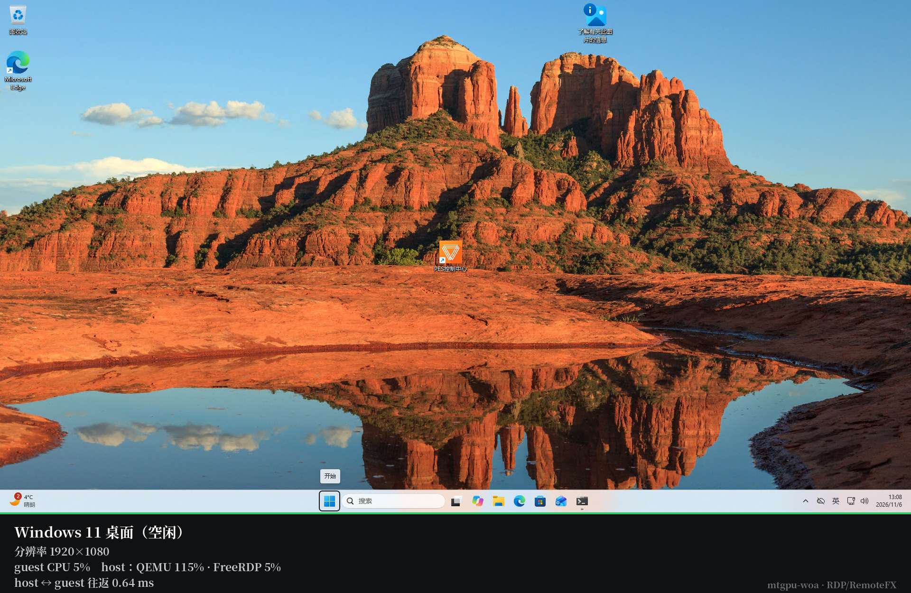
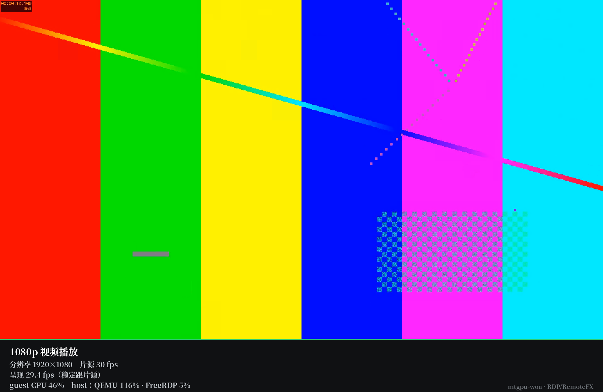
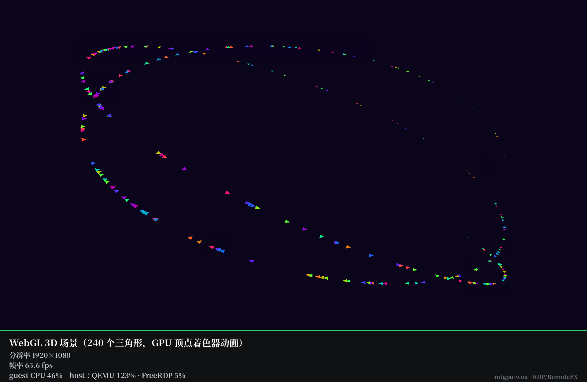
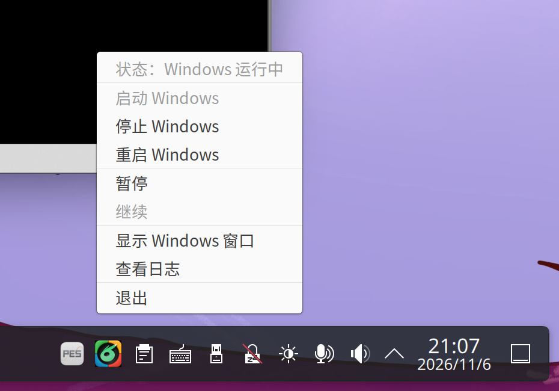

# mtgpu-woa

**Version: v1.0** ([changelog](CHANGELOG.md)) · **[中文说明](README.md)**

**mtgpu-woa** = *Moore Threads GPU + Windows on ARM*.

Run a **Windows 11 ARM64** virtual machine on upstream **QEMU** with
GPU-accelerated rendering and no proprietary components. Display goes over
**RDP with RemoteFX**: the guest encodes with the GPU's hardware encoder (AVC444)
and the host decodes in hardware.

## Highlights

* **RemoteFX through the GPU codec** — the guest encodes in hardware (AVC444),
  the host decodes in hardware.
* **Works with any RDP client that supports RemoteFX (AVC444)** — Windows App,
  mstsc, Remmina, or the FreeRDP build we ship.
* **Clipboard, audio, dynamic resolution, drive redirection, IME and multiple
  monitors come from the protocol** instead of being reimplemented here.
* **Tray control panel** — start the VM in the background, pause/resume, and pull
  the RDP window back when you want it. It never steals focus on its own.
* **qemu-ga integration** — soft shutdown/reboot go through the guest agent;
  only hard power operations touch QEMU directly.

## Screenshots

All taken from a real RDP client on the host, 1920×1080:

| Desktop | 1080p video |
|---|---|
|  |  |

| WebGL 3D | Control panel |
|---|---|
|  |  |

## Architecture

```
        host (ARM64 Linux)                     Windows 11 ARM64 guest
  ┌─────────────────────────────┐        ┌────────────────────────────┐
  │ qemu-system-aarch64 (stock) │        │ TermService (RDP)          │
  │   virtio-blk / virtio-net   │───────►│ viostor / netkvm           │
  │   virtio-serial             │───────►│ qemu-ga                    │
  │   vfio-pci (M1000 mdev)     │───────►│ M1000 vGPU driver          │
  │ -display dbus (fallback)    │──► D-Bus socket                     │
  │ -qmp unix:…sock             │──► QMP (power / pause / status)     │
  └─────────────────────────────┘        └───────────────┬────────────┘
                                                          │ TCP 3389
                                                          │ RDP + RemoteFX
                                                          │ AVC444 (GPU encode)
  ┌─────────────────────────────┐                         │
  │ host FreeRDP 3 (GPU decode) ◄─────────────────────────┘
  │ winvm launcher · tray panel │
  └─────────────────────────────┘
```

## Requirements

**Host**

* ARM64 Linux. Tested on **Ubuntu 24.04.4 LTS, kernel 7.0.14**, KDE Plasma 6 /
  Wayland (the machine ships with AIOS; the desktop was replaced with KDE 6 —
  see <https://github.com/yeungtuzi/mtgpu-kde>)
* QEMU ≥ 8.2 (8.2.2 from the distro was used; the RDP path does not need D-Bus
  display, only the fallback viewer does)
* FreeRDP 3 **built with GFX/H.264** — the distro package is `WITH_GFX_H264=OFF`
  and cannot decode AVC444. A prebuilt deb is attached to the release.
* KDE Plasma 6 or GNOME, Wayland or X11
* PipeWire or PulseAudio
* Optional: Moore Threads M1000 GPU plus its host driver (provides the mdev)

**Guest**

* Windows 11 ARM64
* Official [virtio-win](https://github.com/virtio-win/virtio-win-pkg-scripts)
  drivers: `viostor` (disk), `netkvm` (network); `viogpudo` only for the fallback
  display path
* The installer enables Remote Desktop, turns on RemoteFX/AVC444 and lifts the
  default 30 Hz frame cap

## Install

Full steps and troubleshooting: **[docs/INSTALL.md](docs/INSTALL.md)** (Chinese).
Three commands:

```sh
# 1) host: launcher, tray panel, icons, autostart, and the AVC444-capable FreeRDP
tar xzf winvm-host-1.0.tar.gz -C /tmp/winvm-host && sudo /tmp/winvm-host/install-host.sh

# 2) guest: after Windows + virtio drivers, in an elevated PowerShell
.\install-guest.ps1 -WithAgent

# 3) host: set the password and start
sudo sed -i 's/^RDP_PASS=.*/RDP_PASS=yourpassword/' /etc/winvm.conf && sudo winvm start
```

## Control panel

The tray icon colour is the state: **black** = powered off, **green** = running,
**red** = fault, **amber** = paused. The menu offers status, start, stop, restart,
pause/resume, *Show Windows window* (brings the RDP client back and logs in),
view log, quit.

Nothing auto-reconnects: the VM keeps running in the background and you decide
when to bring the window back. *Show Windows window* is greyed out while the VM
is not running — start it first.

## Usage

```sh
sudo winvm start | show | status | pause | resume | reboot | stop
sudo winvm res 1920x1080
```

Verified over RDP: AVC444 hardware encoding, audio redirection, bidirectional
clipboard, drive redirection, dynamic resolution, Chinese IME, qemu-ga soft
shutdown/reboot.

**The desktop is bound to `127.0.0.1` by default.** To reach it from another
machine, set `RDP_BIND=0.0.0.0` in `/etc/winvm.conf`.

## Performance

Measured at 1920×1080 with a real RDP client on the host:

| Scene | Frame rate |
|---|---|
| WebGL 3D (240 triangles, vertex-shader animation) | 65.6 fps |
| 1080p / 30 fps video | 29.4 fps (tracks the source) |
| Idle desktop | matches the 60 Hz refresh rate |

These are **what reaches the screen**, not what the GPU can render — just like a
60 Hz monitor caps what you see from a much faster card. The rendering itself
happens on the vGPU and runs well ahead of that pace; the numbers above describe
the experience ceiling. Higher resolutions cost more encoding and lower the
rate, which `winvm res` can trade off.

Harness: `bench/rafvid.html` (video + WebGL + rAF counting) and
`bench/benchserver.py` (result collection). The 30 Hz ceiling people hit is
Windows' own RDP throttle (fixed in the guest installer), not a GPU limitation.

Older measurements from the pre-RDP display path live in the git history and
the earlier releases.

## Security

Keep the RDP endpoint local as described above; that is the only network-facing
piece of the setup.

## Layout

```
bin/winvm                 launcher (RDP first, reads /etc/winvm.conf)
host/winvm-tray.py        control panel (tray, four-state icon)
host/icons/               tray icons (black/green/red/amber)
scripts/install-host.sh   one-shot host install (includes the FreeRDP deb)
scripts/install-guest.ps1 one-shot guest install (RDP + RemoteFX + qemu-ga)
guest/qemu-ga/            qemu-ga for Windows ARM64, dependencies, licences
bench/                    browser 2D/3D benchmarks
dist/                     prebuilt FreeRDP deb
docs/                     install guide, architecture notes (zh + en)
```

## License

Apache-2.0. See [LICENSE](LICENSE).
