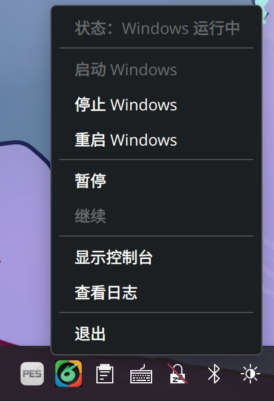
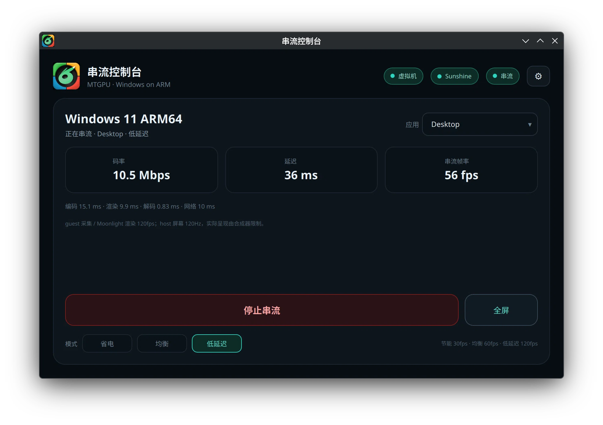
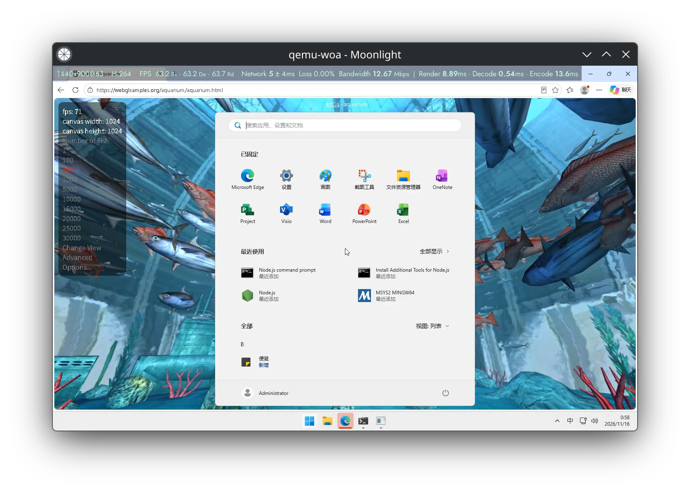

# mtgpu-woa

**Windows 11 ARM64 on KVM/QEMU, accelerated by a Moore Threads M1000 vGPU and streamed to the
Linux host through native Moonlight + Sunshine.**

The rabbit owns VM power/state and the four-state icon. The **Stream Console**
(Qt 6 / QML native window) owns stream start/stop, runtime fullscreen, bandwidth/latency/FPS
and settings.

Version `0.1.1` · [Changelog](CHANGELOG.md) · **[中文说明](README.md)**

> The native Moonlight/Sunshine path is the current default. The legacy RDP/FreeRDP path is
> still in the tree but is not the default interaction model and is outside this README's scope.

## Architecture

```
Host: Ubuntu 24.04 ARM64 / KDE Plasma 6 Wayland
  rabbit ── winvm start/stop/restart/pause ─────────────┐
       │ "Show console"                                      ▼
  Stream Console (Qt6/QML) ── FastAPI :8760 ── Moonlight V+ ── QEMU/KVM + MT vGPU
       │ bandwidth/latency/FPS/fullscreen                      │ localhost
       └──────────────────────────────────────────────────────┼──────────────┐
                                                              ▼              │
                                                Windows 11 ARM64 guest        │
                                                Sunshine (source build)       │
                                                MT H.264 MFT / QGA / audio    │
```

- Video: Sunshine encodes with the MT VPU H.264 MFT; Moonlight V+ decodes/renders on the host.
- Control: the backend drives Moonlight CLI and QEMU; QGA/QMP provide guest power and state.
- Audio uses the native Moonlight/Sunshine channel. Two-way clipboard is an optional text bridge.

## Screenshots

| Rabbit (Windows running) | Stream Console (low-latency) |
|---|---|
|  |  |



> Measured on the current build: the low-latency preset targets 120fps; the console and
> Moonlight overlay show ~56–63fps, and the host panel runs at 120Hz. Presented frames are
> compositor-limited.

## Features

- Native Qt 6/QML console; no Chrome/Electron.
- Rabbit tray: start/stop/restart Windows, pause/resume, four-state icon, show console, logs.
- Single instance: opening the console again raises the existing window; closing it stops
  polling and exits.
- Three presets: powersave 30fps, balanced 60fps (default), low-latency 120fps.
- Runtime fullscreen without reconnecting (EWMH; `Ctrl+Alt+Shift+F` also works).
- Real stats: bandwidth, end-to-end latency (encode + render + decode + network), stream FPS.
- Lightweight guest: hidden Sunshine console, `min_log_level=error`, QGA `guest-exec` fixed.

## Requirements

| Where | Requirement |
|---|---|
| Host | Ubuntu 24.04 ARM64, KVM, KDE Plasma 6 Wayland (StatusNotifierItem tray) |
| Host | QEMU 8.2.2, Qt 6, FFmpeg 6.x, SDL2, libplacebo; Moonlight V+ source build |
| Host | Moore Threads M1000 vGPU driver + mdev/vfio (**proprietary, not in this repo**) |
| Guest | Windows 11 ARM64 image/license (bring your own), virtio drivers |
| Guest | MSYS2 CLANGARM64 + CMake/Ninja + Node.js ARM64 for the Sunshine source build |
| Network | Everything on loopback; QEMU forwards Sunshine ports to 127.0.0.1 |

No MT vGPU/MFT means no hardware encoding. Windows, the MT driver and PES tooling must be
obtained legally by the user.

## Quick start

### Host

```bash
git clone https://github.com/yeungtuzi/mtgpu-woa.git
cd mtgpu-woa

sudo ./scripts/install-host.sh          # QEMU launcher / rabbit / autostart
./scripts/build-moonlight-host.sh       # Moonlight V+ -> /opt/mtgpu-woa/moonlight
sudo ./scripts/install-streamhub.sh     # FastAPI backend + legacy web client
sudo ./scripts/install-streamhub-native.sh  # native Qt6 console
```

`install-host.sh` also checks the legacy FreeRDP client; the native path does not use it.

### Guest

Install Windows 11 ARM64 and the virtio drivers, copy `scripts/` and `guest/qemu-ga/` into the
guest, then from an Administrator PowerShell:

```powershell
powershell -ExecutionPolicy Bypass -File scripts/install-guest.ps1
powershell -ExecutionPolicy Bypass -File scripts/build-sunshine-guest.ps1
```

Sunshine lands in `C:\mtgpu-woa\sunshine-built\sunshine.exe`; the scheduled task
`sun-standalone` starts it hidden. See [scripts/guest/sunshine/README.md](scripts/guest/sunshine/README.md).

### First pairing

1. Open the Sunshine Web UI at `https://127.0.0.1:47990` and set credentials.
2. Add `127.0.0.1` once in the Moonlight GUI and enter the PIN from Sunshine.
3. Afterwards the console reuses the pairing through Moonlight CLI.

### Run

- Tray → **Start Windows** (starts QEMU only).
- Tray → **Show console**.
- Pick an app → **Start stream**; toggle **Fullscreen** at runtime.
- Closing the console exits it and stops polling; the tray stays available.

## Usage

### Modes

| Preset | Resolution | FPS | Bitrate | Notes |
|---|---|---|---|---|
| Powersave | 1280×720 | 30 | 15 Mbps | lowest load |
| Balanced (default) | 1600×900 | 60 | 25 Mbps | desktop/video |
| Low latency | 1440×900 | 120 | 30 Mbps | more responsive, higher VPU/CPU |

The guest helper updates Sunshine's manual refresh rate when the target FPS changes. The
virtual display may overshoot; excess frames are dropped. Bitrate mostly affects quality and
bandwidth, not encode latency.

### Stats

- **Bandwidth**: Moonlight Bandwidth.
- **Latency**: Encode + Render + Decode + Network. If any component is missing (e.g. Sunshine
  does not report encode latency), the UI shows `—` instead of passing network latency off as total.
- **Stream FPS**: client receive/render pipeline FPS, **not** the panel's presented frame rate.
  The host refresh rate is only a footnote.

### Fullscreen

The console button (or `Ctrl+Alt+Shift+F`) toggles `_NET_WM_STATE_FULLSCREEN` on the Moonlight
window via EWMH, without restarting the stream. The tray no longer launches Moonlight directly.

### Audio / clipboard

Audio uses the native Moonlight/Sunshine channel. Two-way text clipboard is a separate bridge
(~1.5s, text only): [scripts/guest/clipboard/README.md](scripts/guest/clipboard/README.md).

## Configuration

```bash
sudo cp winvm.conf.example /etc/winvm.conf
sudoedit /etc/winvm.conf
```

Key entries: `IMG`/`VARS`, `MEM`/`SMP`, `ENABLE_GPU`/`MDEV_TYPE`/`MDEV_PARENT`, `SUNSHINE_FWD`.
`MODE=viewer` is the default; `rdp` is the legacy path.

Logs:

| Log | Path |
|---|---|
| Moonlight stats | `/opt/mtgpu-woa/moonlight/streamhub-stats.log` |
| Console backend | `/opt/mtgpu-woa/streamhub/streamhub.log` |
| QEMU / tray | `/tmp/winvm-qemu.log`, `/tmp/winvm-tray.log` |
| Guest Sunshine | hidden console; `min_log_level=error` (use `info` for debugging) |

## How it works

- Moonlight V+ patch `vendor/patches/moonlight-qt/0002-streamhub-stats.patch` logs
  `StreamHub stats` to stderr once per second.
- FastAPI backend `apps/streamhub/backend/app.py` exposes `/api/stream`,
  `/api/stream/fullscreen`, `/api/stream/stats`, `/api/settings`, `/api/vm` on `127.0.0.1:8760`.
- Qt console `apps/streamhub-native/`; `QLocalServer` provides single-instance behavior.
- Guest MFT proxy `scripts/guest/mft/` adapts the MT async MFT for Sunshine.
- QGA bundle `guest/qemu-ga/` includes the Windows ARM64 binary and GLib spawn helper.
- `scripts/guest/set-sunshine-fps.sh` applies the per-preset refresh rate.

## Project layout

```
apps/streamhub-native/     Qt6/QML console
apps/streamhub/            FastAPI backend + legacy web client
host/winvm-tray.py         rabbit
bin/winvm                  QEMU launcher / QMP+QGA wrapper
guest/qemu-ga/             Windows ARM64 qemu-ga + GLib helper
scripts/                   host/guest install, Moonlight/Sunshine builds, patches
scripts/guest/mft/         MT MFT sync proxy
scripts/guest/clipboard/   two-way text clipboard bridge
vendor/                    third-party sources, patches, licenses, source offer
docs/                      install, latency tuning, architecture
```

## Security

- Backend and Sunshine/Moonlight ports bind loopback only. Do not expose them publicly.
- Set a strong Sunshine Web UI password; do not reuse example credentials.
- Windows, MT drivers and PES are proprietary and must be supplied by the user.

## Troubleshooting

| Symptom | Check |
|---|---|
| No tray icon | StatusNotifierItem: KDE native; GNOME needs the AppIndicator extension |
| No picture | QEMU running? Sunshine reachable? Check `/tmp/winvm-qemu.log` and backend log |
| Low/30fps stream | Sunshine `minimum_fps_target`, guest refresh rate; see [docs/latency-tuning.md](docs/latency-tuning.md) |
| Fullscreen glitches / taskbar flashing | Use the console's fullscreen, not a direct tray-launched Moonlight |
| Frozen picture after changing Windows resolution | Do not change it inside Windows; use the console settings |
| Guest black console / log spam | Sunshine is hidden via VBS with `min_log_level=error`; check other debug shells |
| Console still polling after close | Current builds exit on close; check for stale instances |
| Clipboard/audio issues | Audio is native; clipboard is a text-only bridge |

## License

Original code is **Apache-2.0** ([LICENSE](LICENSE)). Third-party components keep their own
licenses and are aggregated, not relicensed:

| Component | License |
|---|---|
| Moonlight V+, Sunshine (with our patches) | GPL-3.0 |
| QEMU / QEMU Guest Agent | GPL-2.0 |
| FreeRDP (legacy path) | Apache-2.0 |
| Qt 6 / KDE Frameworks / GLib / libplacebo | LGPL-3.0 / LGPL-2.1-or-later |
| SDL2 | zlib |

- Manifest, patches, full license texts: [vendor/SOURCES.md](vendor/SOURCES.md),
  [vendor/README.md](vendor/README.md).
- GPL/LGPL source offer: [vendor/SOURCE-OFFER.md](vendor/SOURCE-OFFER.md).
- QEMU is unmodified and not redistributed; QEMU/Qt/KDE/FFmpeg/SDL2/libplacebo come from the distro.
- Proprietary: MT VPU driver/MFT, Windows 11 ARM64 image, PES/MT tooling; see
  [vendor/PROPRIETARY.md](vendor/PROPRIETARY.md).

## Known limitations

- Guest virtual-display refresh/capture may not exactly match the target; frames can be dropped.
- Sunshine is source-built; the ARM64 Web UI may need the official `assets/web` fallback.
- Hardware encoding depends on the proprietary MT driver/MFT.
- The legacy RDP/FreeRDP path remains but is not the default or covered by this README's validation.
