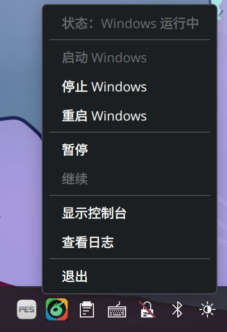
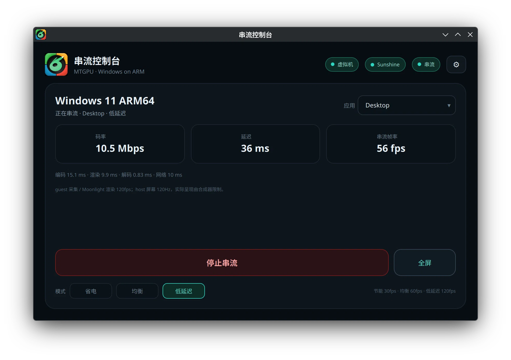
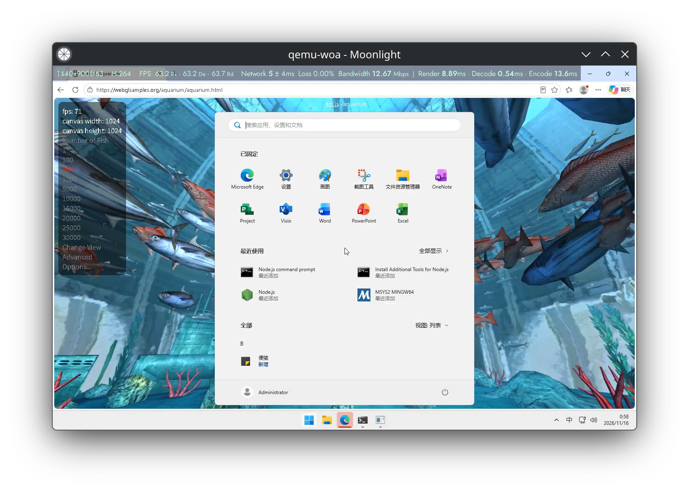

# mtgpu-woa

**在 ARM64 Linux 上用 KVM/QEMU 跑 Windows 11 ARM64，由 Moore Threads M1000 vGPU 硬件加速，
再通过原生 Moonlight/Sunshine 串流回宿主桌面。**

兔头负责虚拟机电源、状态与四色图标；**串流控制台**（Qt 6 / QML，原生窗口）
负责开始/停止串流、运行中全屏切换、码率/延迟/帧率与设置。

版本：`0.1.1` · [更新记录](CHANGELOG.md) · [English](README.en.md)

> 当前主线是 **Moonlight + Sunshine 原生串流**。仓库里仍保留 RDP/FreeRDP 历史路径，
> 但它不再是默认交互方式；本 README 只描述当前主线。

---

## 架构

```
┌──────────────────── 宿主：Ubuntu 24.04 ARM64 / KDE Plasma 6 Wayland ────────────────────┐
│                                                                                          │
│  兔头 ── winvm start/stop/restart/pause ──────────────┐                              │
│      │ 显示控制台                                          ▼                              │
│  串流控制台 (Qt6/QML) ── FastAPI :8760 ── Moonlight V+ ── QEMU/KVM ── MT vGPU (vfio-mdev) │
│      │ 码率/延迟/帧率/全屏                                  │ localhost                   │
│      └─────────────────────────────────────────────────────┼──────────────┐              │
│                                                            ▼              │              │
│                                              Windows 11 ARM64 guest       │              │
│                                              Sunshine (源码构建)           │              │
│                                              MT H.264 MFT / QGA / 音频     │              │
└──────────────────────────────────────────────────────────────────────────────────────────┘
```

- 画面：Sunshine 在 guest 内用 MT VPU 的 H.264 MFT 编码 → 宿主 Moonlight V+ 解码渲染。
- 控制：宿主控制台通过 FastAPI 调 Moonlight CLI 和 QEMU；guest 电源/状态由 QGA 与 QMP 提供。
- 音频：Moonlight/Sunshine 原生音频通道；剪贴板双向同步是额外的轻量 bridge（见下文）。

## 截图

| 兔头（Windows 运行中） | 串流控制台（低延迟模式） |
|---|---|
|  |  |



> 截图来自当前版本实测：低延迟模式目标 120fps；控制台/Moonlight overlay 显示约 56–63fps，
> host 屏幕 120Hz，实际呈现由合成器限制。

## 特性

- **原生控制台，不依赖 Chrome/Electron**：Qt 6 + QML，跟随 Wayland HiDPI。
- **兔头**：启动/停止/重启 Windows、暂停/继续、四色状态图标、显示控制台、查看日志。
- **单实例**：控制台重复打开只唤醒已有窗口；关闭窗口即退出并停止状态/统计轮询。
- **三档帧率**：节能 30fps、均衡 60fps（默认）、低延迟 120fps。
- **运行中全屏**：不重连，直接对 Moonlight 窗口做 EWMH fullscreen；也可 `Ctrl+Alt+Shift+F`。
- **真实统计**：码率、端到端延迟、串流帧率；延迟拆分为编码/渲染/解码/网络。
- **轻量 guest**：Sunshine 隐藏 console 启动、`min_log_level=error`；QGA 修复 `guest-exec`。
- **一站式脚本 + 明确许可证**：小体积/改过的源码随仓库，大系统包由发行版安装。

## 环境要求

| 位置 | 要求 |
|---|---|
| 宿主 | Ubuntu 24.04 ARM64（aarch64）、KVM、KDE Plasma 6 Wayland（托盘走 StatusNotifierItem） |
| 宿主 | QEMU 8.2.2、Qt 6、FFmpeg 6.x、SDL2、libplacebo；Moonlight V+ 源码构建 |
| 宿主 | Moore Threads M1000 vGPU 驱动 + mdev/vfio；**这是厂商专有组件，不在本仓库** |
| guest | Windows 11 ARM64（镜像/授权自备）、virtio 驱动（viostor/NetKVM/vioser） |
| guest | MSYS2 CLANGARM64 + CMake/Ninja + Node.js ARM64（源码构建 Sunshine） |
| 网络 | 全部走本机回环；Sunshine 47984/47989/47990/48010 等端口由 QEMU hostfwd 转发到 127.0.0.1 |

> 没有 MT vGPU/MFT 时无法使用硬件编码；Windows 镜像、MT 驱动和 PES 工具都需要用户自行合法获取。

## 快速开始

### 1. 宿主安装

```bash
git clone https://github.com/yeungtuzi/mtgpu-woa.git
cd mtgpu-woa

# QEMU 启动器 / 兔头 / 开机自启（脚本仍会顺带安装历史 RDP 客户端）
sudo ./scripts/install-host.sh

# Moonlight V+（aarch64），安装到 /opt/mtgpu-woa/moonlight
./scripts/build-moonlight-host.sh

# FastAPI 后端 + 旧 Web 前端（控制台只依赖后端 :8760）
sudo ./scripts/install-streamhub.sh

# 原生串流控制台（Qt6/QML）
sudo ./scripts/install-streamhub-native.sh
```

`install-host.sh` 里的 FreeRDP 检查属于旧 RDP 路径；原生串流不使用它。
如果只跑原生方案，可以忽略 RDP 客户端告警，但不要跳过 `winvm`/托盘本身。

### 2. guest 安装

先在 Windows 11 ARM64 里装好 virtio 驱动，把仓库的 `scripts/`、`guest/qemu-ga/`
拷进 guest，管理员 PowerShell：

```powershell
# qemu-ga、电源/会话基础配置（脚本里也有历史 RDP 设置，不影响原生串流）
powershell -ExecutionPolicy Bypass -File scripts/install-guest.ps1

# 源码构建 Sunshine（MSYS2 ARM64 + Node.js ARM64）
powershell -ExecutionPolicy Bypass -File scripts/build-sunshine-guest.ps1
```

构建产物在 `C:\mtgpu-woa\sunshine-built\sunshine.exe`，计划任务 `sun-standalone`
以隐藏窗口启动，配置在 `C:\mtgpu-woa\sunshine-built\config\sunshine.conf`。
细节与已知构建坑见 [scripts/guest/sunshine/README.md](scripts/guest/sunshine/README.md)。

### 3. 首次配对

1. guest 内打开 Sunshine Web UI：`https://127.0.0.1:47990`（宿主经 hostfwd 访问），
   设置管理员账号/密码。
2. 宿主机先用 Moonlight GUI 添加 `127.0.0.1`，在 Sunshine Web UI 输入 PIN 完成配对；
   之后控制台通过 Moonlight CLI 复用配对信息。
3. 配对后，控制台“开始串流”即可；日常不需要再开 Moonlight GUI。

### 4. 启动

- 托盘 → **启动 Windows**（只启动 QEMU，不直接拉起 Moonlight）。
- 托盘 → **显示控制台**。
- 控制台选择应用 → **开始串流**；运行中可点 **全屏/窗口**。
- 关闭控制台窗口会停止轮询并退出进程；托盘仍保留，可随时再次显示控制台。

## 使用

### 兔头

| 菜单 | 作用 |
|---|---|
| 启动 Windows / 停止 Windows / 重启 Windows | QGA 优雅关机/重启，失败回退 ACPI |
| 暂停 / 继续 | QMP stop/cont |
| 显示控制台 | 打开或唤醒串流控制台（单实例） |
| 查看日志 | 打开串流日志 |
| 退出 | 退出托盘（虚拟机继续运行） |

图标颜色：黑=未运行，绿=运行中，红=故障，半透明绿=暂停中。

### 串流控制台

- **开始/停止串流**：同一按钮切换，不再有“窗口串流/全屏串流”两个启动入口。
- **全屏/窗口**：对运行中的 Moonlight 窗口做 EWMH 切换，不重连。
- **应用**：Desktop / Steam Big Picture 等 Moonlight 应用列表。
- **设置**：分辨率、帧率、码率、拉伸填满、保存并重连。

### 三档模式

| 模式 | 分辨率 | 帧率 | 码率 | 说明 |
|---|---|---|---|---|
| 节能 | 1280×720 | 30fps | 15 Mbps | 最低负载，适合后台/轻办公 |
| 均衡（默认） | 1600×900 | 60fps | 25 Mbps | 日常桌面与视频 |
| 低延迟 | 1440×900 | 120fps | 30 Mbps | 更跟手，VPU/CPU 占用更高 |

- 帧率目标由 Moonlight `--fps` 决定；guest 侧 helper 会在档位变化时设置 Sunshine 的
  manual refresh rate 并重启 Sunshine。
- 虚拟显示刷新率并不总能精确匹配目标；**多余帧会被丢弃**，以控制台/客户端目标为准。
- 码率主要影响画质/带宽，不显著影响编码延迟；localhost 可放心用 30–50 Mbps。

### 统计口径

- **码率**：Moonlight 统计里的 Bandwidth。
- **延迟**：Encode + Render + Decode + Network 之和；四项缺一（例如 Sunshine 未上报编码延迟）就显示 `—`，不会用网络延迟冒充总延迟。
- **串流帧率**：客户端接收/渲染管线的 fps；**不是屏幕实际呈现帧率**。
- 主界面显示的是串流帧率；host 屏幕刷新率只作为脚注，避免把 150+ 的管线数字误当成显示帧率。

### 全屏

- 控制台按钮，或串流中按 `Ctrl+Alt+Shift+F`。
- 后端用 `wmctrl` 对 Moonlight 窗口设置/取消 `_NET_WM_STATE_FULLSCREEN`，不重启串流。
- 托盘不再直接启动 Moonlight，避免旧路径在 Wayland 下全屏异常/KDE 任务栏闪烁。

### 音频与剪贴板

- 音频走 Moonlight/Sunshine 原生通道（宿主 PulseAudio）。
- 双向文本剪贴板由额外 bridge 提供，约 1.5s 延迟、仅文本；
  安装见 [scripts/guest/clipboard/README.md](scripts/guest/clipboard/README.md)。

## 配置

### `/etc/winvm.conf`

```bash
sudo cp winvm.conf.example /etc/winvm.conf
sudoedit /etc/winvm.conf
```

常用项：

- `IMG` / `VARS`：Windows qcow2 与 UEFI vars。
- `MEM` / `SMP`：内存与 vCPU 数。
- `ENABLE_GPU` / `MDEV_TYPE` / `MDEV_PARENT`：MT vGPU mdev。
- `SUNSHINE_FWD`：Sunshine 端口转发（脚本有默认值，通常不用改）。
- `MODE`：`viewer`（默认，virtio-gpu + D-Bus viewer）或历史 `rdp`；原生串流不需要 `rdp`。

### 日志

| 日志 | 位置 |
|---|---|
| Moonlight 统计 | `/opt/mtgpu-woa/moonlight/streamhub-stats.log` |
| 控制台后端 | `/opt/mtgpu-woa/streamhub/streamhub.log` |
| QEMU / 托盘 | `/tmp/winvm-qemu.log`、`/tmp/winvm-tray.log` |
| guest Sunshine | 隐藏 console；`min_log_level=error`，需要排障时临时改回 `info` |

## 工作原理（关键改动）

- **Moonlight V+**：`vendor/patches/moonlight-qt/0002-streamhub-stats.patch` 每秒把
  `StreamHub stats` 写到 stderr；控制台后端解析成码率/延迟/帧率。
- **FastAPI 后端**：`apps/streamhub/backend/app.py`，绑定 `127.0.0.1:8760`；
  `/api/stream`、`/api/stream/fullscreen`、`/api/stream/stats`、`/api/settings`、`/api/vm`。
- **Qt 控制台**：`apps/streamhub-native/`；QML 负责界面，`QLocalServer` 做单实例。
- **guest MFT proxy**：`scripts/guest/mft/` 把 MT 异步 MFT 包成同步接口，Sunshine 才能稳定用硬件编码。
- **QGA**：`guest/qemu-ga/` 随附 ARM64 二进制与 GLib spawn helper，支持 `guest-exec` 和优雅关机。
- **Sunshine**：源码构建 + 隐藏计划任务；`scripts/guest/set-sunshine-fps.sh` 负责档位刷新率。

## 项目结构

```
apps/streamhub-native/     Qt6/QML 串流控制台
apps/streamhub/            FastAPI 后端 + 旧 Web 前端
host/winvm-tray.py         兔头（电源/状态/显示控制台）
bin/winvm                  QEMU 启动器、QMP/QGA 封装
guest/qemu-ga/             Windows ARM64 qemu-ga 与 GLib helper
scripts/                   host/guest 安装、Moonlight/Sunshine 构建、补丁
scripts/guest/mft/         MT MFT 同步代理
scripts/guest/clipboard/   双向文本剪贴板
vendor/                    第三方源码清单、补丁、许可证、source offer
docs/                      安装/延迟调优/架构文档
```

## 安全

- 后端与 Moonlight/Sunshine 端口默认只绑 `127.0.0.1`，不建议暴露到局域网/公网。
- Sunshine Web UI 请设置强密码；不要使用仓库/示例中的默认凭据。
- Windows 镜像、MT 驱动、PES 等专有组件由用户自行提供并遵守其许可。

## 常见问题

| 现象 | 排查 |
|---|---|
| 托盘没有图标 | 需要 StatusNotifierItem：KDE 原生；GNOME 装 AppIndicator 扩展 |
| 启动后没有画面 | 先确认 QEMU 已启动、Sunshine 可达；看 `/tmp/winvm-qemu.log` 与控制台后端日志 |
| 串流帧率很低/卡 30fps | 检查 Sunshine `minimum_fps_target` 与 guest 当前刷新率；见 [docs/latency-tuning.md](docs/latency-tuning.md) |
| 全屏异常/任务栏闪 | 用控制台的“全屏”，不要从托盘直接启动 Moonlight；确认 Moonlight 窗口是 XWayland |
| 改 Windows 分辨率后画面卡住 | 不要在 Windows 设置里手动改；用控制台设置，保存后自动重连 |
| guest 里出现黑框/疯狂日志 | Sunshine console 已改为隐藏 VBS + `min_log_level=error`；若仍有，检查其他调试 PowerShell |
| 控制台关闭后还在轮询 | 当前版本关闭即退出；确认没有旧实例（`pgrep -af streamhub-native`） |
| 剪贴板/音频不同步 | 音频走原生通道；剪贴板是文本 bridge，见 guest clipboard README |

## 许可证

本项目原创代码 **Apache-2.0**（[LICENSE](LICENSE)）。第三方组件**保留各自许可证**，按组件聚合分发：

| 组件 | 许可证 |
|---|---|
| Moonlight V+、Sunshine（含本项目补丁） | GPL-3.0 |
| QEMU / QEMU Guest Agent | GPL-2.0 |
| FreeRDP（历史路径） | Apache-2.0 |
| Qt 6 / KDE Frameworks / GLib / libplacebo | LGPL-3.0 / LGPL-2.1-or-later |
| SDL2 | zlib |

- 源码清单、补丁、许可证全文：[vendor/SOURCES.md](vendor/SOURCES.md)、[vendor/README.md](vendor/README.md)。
- GPL/LGPL 源码提供：[vendor/SOURCE-OFFER.md](vendor/SOURCE-OFFER.md)。
- 小体积/难找/本项目修改过的源码随仓库：`vendor/src/`、`vendor/patches/`、`guest/qemu-ga/`。
- QEMU 未修改、不重分发，由发行版安装；Qt/KDE/FFmpeg/SDL2/libplacebo 同样交给发行版。
- **专有组件**：MT VPU 驱动/MFT、Windows 11 ARM64 镜像、PES/MT 工具，无源码可分发；
  见 [vendor/PROPRIETARY.md](vendor/PROPRIETARY.md)。

## 已知限制

- guest 虚拟显示的刷新率/采集率不总能精确等于目标；多余帧可能被丢弃。
- Sunshine 为源码构建，Web UI 在 ARM64 上可能需要官方 `assets/web` 兜底；见 guest Sunshine README。
- 依赖 MT 厂商驱动/MFT；没有它们只能退回软件编码，性能/延迟不同。
- 旧的 RDP/FreeRDP 路径仍保留，但不再默认启用，也不在本 README 的验收范围内。
