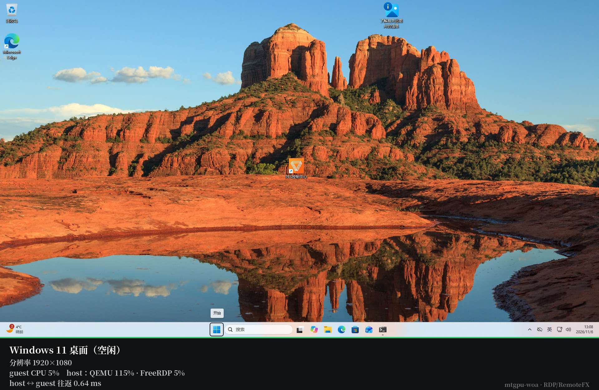
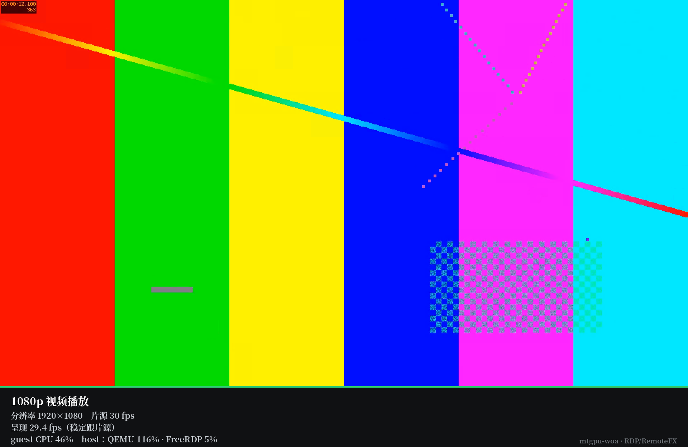
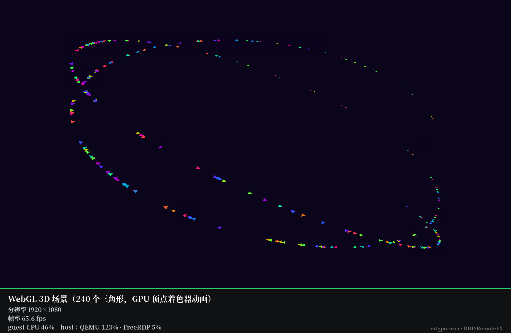
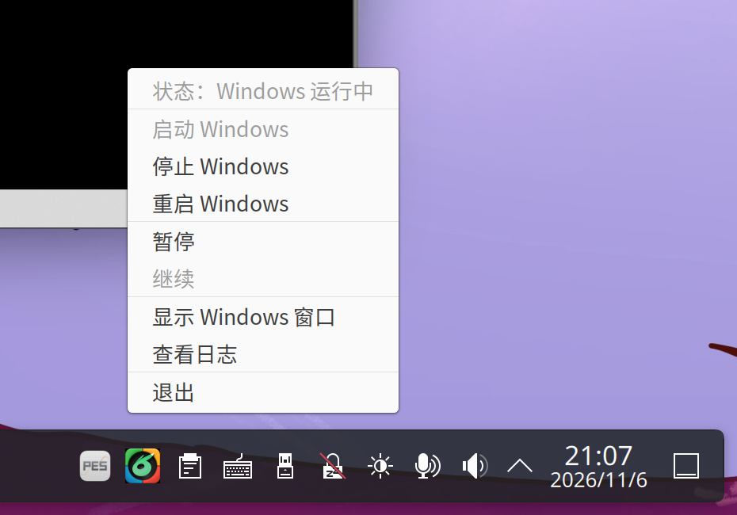

# mtgpu-woa

**版本：v1.0**（[更新记录](CHANGELOG.md)）

**在 KVM/QEMU 上运行 Windows 11 ARM64 并进行 GPU 加速渲染，不引入专有组件，适配摩尔线程 M1000 GPU 与 Ubuntu 24.04 / AIOS。**

**[English](README.en.md)**

---

## 效果

以下截图全部取自**宿主上的真实 RDP 客户端**（FreeRDP 3 + AVC444），1920×1080：

| 桌面 | 1080p 视频 |
|---|---|
|  |  |

| WebGL 3D | 控制面板（托盘） |
|---|---|
|  |  |

> 帧率、占用率均为实测（guest 内计数 + host 侧 `ps`）。WebGL 页面需 `preserveDrawingBuffer:true`，
> 否则 canvas 在 RDP 上会合成为空白——这是 guest 侧合成器的行为，与本项目无关。

## 1.0 亮点

**用 GPU 编解码器实现 RemoteFX 原生支持，性能相比原来的 viewer 大幅提升。**

显示通道换成 Windows 原生的远程桌面栈：画面由 GPU 的硬件编码器编码（AVC444），
宿主硬件解码。1920×1080 下视频跟满片源，3D 与桌面按 60 fps 的节奏刷新——这是画面
到屏幕的速率，不是 GPU 的渲染能力上限。剪贴板、音频、动态分辨率、输入法这些能力直接由协议提供，
不必再自己实现。性能强于原厂预装的私有方案。

原来的 D-Bus + viewer 路径没有删掉，作为兜底保留。

## 项目简介

**mtgpu-woa** = *Moore Threads GPU + Windows on ARM*。

在 ARM64 Linux 上用上游 QEMU 跑 Windows 11 ARM64，大致是这些部件：

* 显示默认走 **RDP**（Windows 自带 Remote Desktop + RemoteFX/AVC444 硬件编码），
  宿主用 FreeRDP 3 连接；`virtio-gpu` + D-Bus 显示协议 + 自带 viewer 作为兼容路径保留；
* 磁盘走 `virtio-blk` + 官方 `viostor` 驱动；
* 网络走 `virtio-net` + 官方 `netkvm` 驱动，user-mode 网络加一条 hostfwd 给 guest agent；
* 音频走 `intel-hda` + QEMU 原生 `pa` 后端；
* 摩尔线程 M1000 通过**标准 vfio-pci** 直通（介质设备 mdev），guest 里用官方 Windows 驱动，
  3D 由 vGPU 硬件渲染。

## 特性

| | |
|---|---|
| 显示 | **RDP（默认）**：Windows 侧 AVC444 硬编，宿主 FreeRDP 3 硬解；virtio-gpu + D-Bus viewer 保留为兜底 |
| 输入 | RDP 标准键鼠通道（含中文输入法、剪贴板） |
| 剪贴板 | RDP 剪贴板重定向，双向同步 |
| 分辨率 | RDP 动态分辨率：拉窗口 guest 立即跟随 |
| 音频 | RDP 音频重定向（`/sound`），直出到 PipeWire/PulseAudio |
| GPU | 摩尔线程 M1000 vGPU 标准 vfio-pci 直通，D3D11 硬件加速 |
| 磁盘 | qcow2 + virtio-blk |
| 控制面板 | 托盘常驻应用，随时查看状态并操作虚拟机：启动 / 停止 / 重启 / 暂停 / 继续，一键把 RDP 窗口拉回前台；图标颜色即状态（黑=没开机、绿=运行中、红=故障、琥珀=暂停） |
| 电源 | 软关机 / 软重启走 qemu-ga，硬电源操作才直接控制 QEMU |

## 架构

```
                宿主 Linux（ARM64）                        Windows 11 ARM64 guest
  ┌──────────────────────────────────────────┐        ┌──────────────────────────┐
  │  qemu-system-aarch64（上游，无补丁）      │        │  TermService（RDP）      │
  │    virtio-blk-pci ───────────────────────┼───────►│  viostor                 │
  │    virtio-net-pci ───────────────────────┼───────►│  netkvm                  │
  │    virtio-serial ────────────────────────┼───────►│  qemu-ga                 │
  │    vfio-pci（M1000 mdev）────────────────┼───────►│  M1000 vGPU 驱动         │
  │    intel-hda（兜底路径用）                │        │                          │
  │  -display dbus（兜底）───────────────────┼──► D-Bus 套接字                 │
  │  -qmp unix:…sock ────────────────────────┼──► QMP（电源/暂停/状态）        │
  └──────────────────────────────────────────┘        └────────────┬─────────────┘
                                                                   │ TCP 3389
                                                                   │ RDP + RemoteFX
                                                                   │ AVC444（GPU 硬编）
  ┌──────────────────────────────────────────┐                     │
  │  宿主 FreeRDP 3（GPU 硬解）◄─────────────┼─────────────────────┘
  │  winvm 启动器 · 托盘控制面板              │
  └──────────────────────────────────────────┘
```

## 环境要求

**宿主**

* ARM64 Linux。实测环境：**Ubuntu 24.04.4 LTS，内核 7.0.14**，KDE Plasma 6 / Wayland
  （原厂预装 AIOS，自行改 KDE 6，见 <https://github.com/yeungtuzi/mtgpu-kde>）
* QEMU ≥ 8.2（实测 8.2.2 发行版包即可；RDP 路径不依赖 D-Bus 显示，只有兜底的 viewer 需要 `--enable-gio`）
* FreeRDP 3，需编入 GFX/H.264 支持（实测 3.32.1；发行版包不满足，项目提供预编译 deb）
* AAVMF UEFI 固件（`qemu-efi-aarch64`）
* 桌面：KDE Plasma 6 或 GNOME，Wayland / X11 均可
* PipeWire 或 PulseAudio
* 可选：摩尔线程 M1000 GPU 及其 host 驱动（提供 mdev）

**guest**

* Windows 11 ARM64
* [virtio-win](https://github.com/virtio-win/virtio-win-pkg-scripts) 官方驱动：
  `viostor`（磁盘）、`netkvm`（网络）、`viogpudo`（仅兜底显示路径需要）
* 安装脚本会启用远程桌面、配置 RemoteFX/AVC444 并解除默认帧率上限

## 安装

完整步骤和排错见 **[docs/INSTALL.md](docs/INSTALL.md)**。三条命令概括：

```sh
# 1) 宿主：装启动器、托盘控制面板、图标、自启动，并换上能解 AVC444 的 FreeRDP
tar xzf winvm-host-1.0.tar.gz -C /tmp/winvm-host && sudo /tmp/winvm-host/install-host.sh

# 2) guest：装完 Windows 11 ARM64 和 virtio 驱动后，管理员 PowerShell 里跑
#    （virtio 驱动从 virtio-win 上游下载 w11/ARM64 目录）
.\install-guest.ps1 -WithAgent

# 3) 宿主：填 RDP 密码并启动
sudo sed -i 's/^RDP_PASS=.*/RDP_PASS=你的密码/' /etc/winvm.conf && sudo winvm start
```

第 2 步做四件事：启用远程桌面与防火墙、打开 RemoteFX/AVC444 硬件编码、
把默认 30 Hz 的帧率节流解开、按需安装 qemu-ga。

> FreeRDP 必须**编入 GFX/H.264**，发行版自带包是 `WITH_GFX_H264=OFF`，连上去只能看到花屏。
> Release 附带的 `freerdp3-winvm_*.deb` 用同样的上游源码构建（只改构建开关、无源码补丁），
> 安装脚本会先移除自带包再装上它。

发布物：

| 内容 | 位置 |
|---|---|
| 宿主启动器 | `bin/winvm` |
| 托盘控制面板（KDE / GNOME） | `host/winvm-tray.py` + `host/winvm-tray-run.sh` + `host/icons/` |
| Windows guest 安装脚本 | `scripts/install-guest.ps1`（`-WithAgent` 可选装 qemu-ga） |
| 宿主安装脚本 | `scripts/install-host.sh` |
| 帧率基准页 | `bench/rafvid.html` |

## 控制面板（托盘）

安装后托盘常驻一枚项目图标，**颜色就是状态**：

| 黑 | 绿 | 红 | 琥珀 |
|---|---|---|---|
| 没开机 | 运行中 | 故障 | 暂停中 |

点开菜单：

| 菜单项 | 作用 |
|---|---|
| 状态 | 当前状态（运行中 / 已暂停 / 未运行 / 异常） |
| 启动 Windows | 后台把 VM 跑起来，**不弹窗口** |
| 停止 | 先请 guest 软关机（qemu-ga），失败再退回 ACPI |
| 重启 | guest 软重启 |
| 暂停 / 继续 | QMP 暂停与恢复 |
| 显示 Windows 窗口 | 拉起 RDP 客户端并自动登录，回到桌面 |
| 查看日志 | 打开运行日志 |
| 退出 | 关掉托盘，VM 继续在后台跑 |

设计上**不自动重连**：VM 在后台跑着，什么时候回到窗口由你决定，不会被弹窗打断；
VM 没在跑时「显示 Windows 窗口」是灰的，得先点「启动」。

控制面板是**可选**的——所有操作都能用命令行完成，托盘只是把常用几条放在手边。

## 启动画面（KDE 欢迎画面 / Splash）

`share/plasma/look-and-feel/org.aibook.splash/` 是一个 KDE Plasma 6 的欢迎画面主题：

- 纯黑背景，兔子图标居中，宽度约为屏幕的 **1/4**（`width/4`，同时不超过 `height/2`）
- 边框四角的颜色（绿 / 黄 / 红 / 蓝）按顺序从灰色中点亮，2.8 秒一个循环
- 兔子本身不动：动画只叠加四个「只保留一角彩色边框」的整图精灵，
  耳朵尖（探进右上角的那一段）属于灰色底图，不会被动画波及


安装（用户级，不需要 root）：

```bash
./scripts/install-splash.sh
# 系统级：sudo ./scripts/install-splash.sh --system
```

然后在 **系统设置 → 全局主题 → 欢迎画面** 里选择 **aibook**。

素材从 `share/icons/mtgpu-woa-512.png` 生成（饱和度选区 + 四象限切分）：

```bash
python3 tools/gen-splash-assets.py 720
```

## 使用

```sh
sudo winvm start      # 后台起 VM，并在需要时连上 RDP
sudo winvm show       # 把 RDP 窗口拉回来（VM 已在后台运行时）
sudo winvm status     # 看 VM / 客户端 / qemu-ga 状态
sudo winvm pause      # 暂停
sudo winvm resume     # 继续
sudo winvm reboot     # guest 软重启
sudo winvm stop       # 软关机（qemu-ga → 退回 ACPI）
sudo winvm res 1920x1080   # 改 guest 分辨率
```

远程桌面**默认只绑定 `127.0.0.1`**，别的机器连不上。要从另一台机器连（Windows App /
mstsc / Remmina 等），把 `/etc/winvm.conf` 里的 `RDP_BIND` 改成 `0.0.0.0` 即可。

已验证的协议能力：

| 能力 | 状态 |
|---|---|
| 画面（AVC444 + M1000 硬件编码） | ✅ |
| 音频重定向 | ✅ |
| 剪贴板双向 | ✅ |
| 驱动器重定向（`/drive:`） | ✅ |
| 动态分辨率 | ✅ |
| 中文输入法 | ✅ |
| qemu-ga 软关机 / 软重启 | ✅ |

## 帧率：RDP 默认 30fps 限制及解除方法

RDP **默认不支持超过 30fps**（[微软文档](https://learn.microsoft.com/zh-tw/troubleshoot/windows-server/remote/frame-rate-limited-to-30-fps)），
这是协议层的节流，与显卡驱动无关。在 guest 里设置：

```powershell
$b = "HKLM:\SYSTEM\CurrentControlSet\Control\Terminal Server\WinStations"
Set-ItemProperty -Path $b           -Name DWMFRAMEINTERVAL -Value 15 -Type DWord
Set-ItemProperty -Path "$b\RDP-Tcp" -Name DWMFRAMEINTERVAL -Value 15 -Type DWord
Restart-Service TermService -Force
```

实测（1920x1080）：

| 状态 | 帧率 |
|---|---|
| 未设置 | 32.2 ~ 32.5 |
| 设置后（小窗口） | **64.7** |
| 设置后（满屏 1860x885） | **53.5** |

`15` 毫秒对应约 66fps 的上限。若设置后读回为空，说明没写进去，
务必 `Get-ItemProperty` 确认。

## 性能

1920×1080 实测（宿主真实 RDP 客户端）：

| 场景 | 帧率 |
|---|---|
| WebGL 3D（240 个三角形，顶点着色器动画） | 65.6 fps |
| 1080p / 30 fps 视频 | 29.4 fps（跟满片源） |
| 桌面空闲 | 与 60 Hz 刷新率一致 |

这些数字是**画面到达屏幕的速率**，不是 GPU 的渲染能力——就像再强的显卡接在 60 Hz
显示器上，你看到的也只有 60 fps。实际渲染负载由 vGPU 承担，远高于这个节奏；表里的
数值反映的是"看得到多少"，也就是使用体验的上限。

分辨率越高编码负载越重，帧率会随之下降，可用 `sudo winvm res 1920x1080` 按需调整。

测法：`bench/rafvid.html`（视频 + WebGL + rAF 计数）与 `bench/benchserver.py`（收集结果）。

**关于 30 fps 上限**：不少人连上去发现帧率卡在 30 左右，那是 Windows 远程桌面的默认节流，
不是 GPU 的限制。`install-guest.ps1` 会解除它，详见
[「帧率：RDP 默认 30fps 限制及解除方法」](#帧率rdp-默认-30fps-限制及解除方法)。

## 安全须知

### 远程桌面默认不对外

`RDP_BIND` 默认 `127.0.0.1`，QEMU 的 hostfwd 只转发本机回环；RDP 一旦对外就是整台
Windows（含剪贴板、驱动器重定向），要开请自己改 `/etc/winvm.conf`。

## 常见问题

**Q：连上去画面花屏 / 一块块绿块？**
客户端没有解码 AVC444 的能力。发行版的 FreeRDP 编译时 `WITH_GFX_H264=OFF`，
换成本 Release 附带的 `freerdp3-winvm` deb；Windows App / mstsc 自带解码，不受影响。

**Q：帧率卡在 30 左右上不去？**
Windows 远程桌面默认按 30 Hz 节流。`install-guest.ps1` 会写 `DWMFRAMEINTERVAL=15`
（两个 `WinStations` 键都要写），改完必须 `Restart-Service TermService` 才生效。

**Q：客户端连不上 `宿主IP:3389`？**
guest 内的防火墙规则和 `fDenyTSConnections=0` 由安装脚本设置；宿主侧确认端口在监听
（`ss -ltnp | grep 3389`）以及 ufw 放行。

**Q：`winvm stop` 之后 QEMU 还在？**
`stop` 先请 qemu-ga 软关机，失败再发 ACPI，Windows 关机需要几十秒，等不到会打印警告；
不要用 `kill -9`，会留下 qcow2 锁。

**Q：WebGL 页面在 RDP 里是一片空白？**
canvas 需要 `preserveDrawingBuffer:true`，否则合成器交出来的是空表面。
这是 guest 侧行为，与本项目无关（`bench/rafvid.html` 就是这么写的）。

**Q：QEMU 启动失败，日志是空的？**
看 `/tmp/winvm-qemu.log` 和 `/tmp/winvm-tray.log`。最常见的是镜像被另一个 QEMU 占着。

## 项目标签

`qemu` `kvm` `arm64` `windows-11` `aarch64` `virtualization` `rdp` `remotefx`
`avc444` `freerdp` `gpu-encoding` `vfio-pci` `gpu-passthrough` `moore-threads` `m1000`
`aios` `ubuntu-24.04` `kde-plasma` `wayland`

## 目录结构

```
bin/winvm                 启动器（RDP 优先，配置 /etc/winvm.conf）
host/winvm-tray.py        控制面板（托盘，四态图标）
host/winvm-tray-run.sh    托盘守护包装
host/icons/               托盘图标（黑/绿/红/琥珀）
scripts/install-host.sh   宿主一键安装（含 FreeRDP deb）
scripts/install-guest.ps1 guest 一键安装（RDP + RemoteFX + qemu-ga）
guest/qemu-ga/            qemu-ga for Windows ARM64 及依赖、许可证
guest/winvm-agent.ps1     可选的 guest 会话助手
bench/                    浏览器 2D/3D 基准页与结果收集
dist/                     预编译 FreeRDP deb
share/icons/              项目图标（512 原图即启动画面素材）
share/plasma/look-and-feel/org.aibook.splash/
                          KDE 欢迎画面主题（黑底兔子，边框轮流点亮）
tools/gen-splash-assets.py 从 512 图标生成启动画面素材
scripts/install-splash.sh  安装欢迎画面主题
docs/                     安装指南、架构、基准数据（中英双语）
docs/images/              发布用截图
```


## 许可证

Apache-2.0，见 [LICENSE](LICENSE)。
