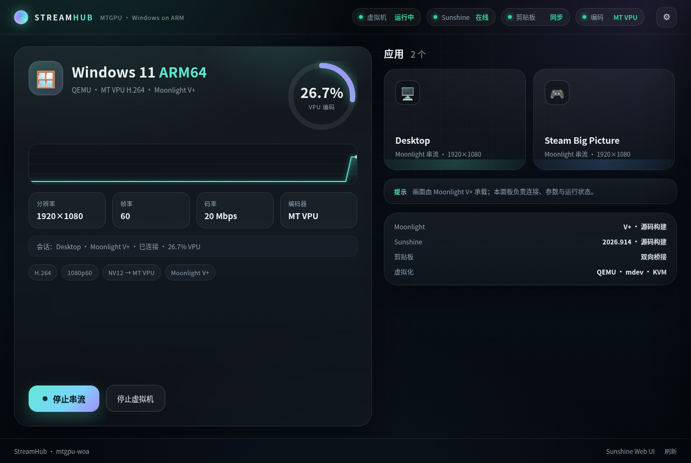

# StreamHub

A small, good-looking local control client for the mtgpu-woa Moonlight/Sunshine
stack. It does not reimplement streaming: Moonlight V+ stays the video engine;
StreamHub handles app selection, parameters, status and one-click connect.



## Features

- Status pills: VM, Sunshine, clipboard bridge, encoder (MT VPU / software).
- VPU ring + sparkline (polled from `mthreads-gmi` via a cached backend).
- App cards from `moonlight list 127.0.0.1`; click to stream.
- Settings drawer: resolution / FPS / bitrate (persisted to `~/.config/streamhub/settings.json`).
- VM start/stop through `sudo -n winvm`.
- Dark "aurora glass" theme, keyboard friendly, zero frontend dependencies.

## Run

```bash
scripts/install-streamhub.sh        # installs to /opt/mtgpu-woa/streamhub
/opt/mtgpu-woa/streamhub/streamhub.sh
```

Backend: FastAPI on `127.0.0.1:8760`; UI served at `/` and opened in a Chrome
app window (a desktop entry is installed as well).

`frontend/preview.html` is a self-contained copy (inlined CSS + mock data) used
to iterate on the UI without a backend; render it with any browser.
